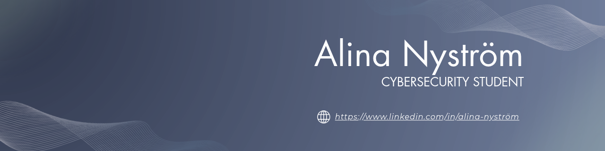

  

## Hi, I'm Alina

I'm an IT Security student working towards becoming a cybersecurity specialist. I use this space to document my hands-on labs, experiments and projects as I develop my technical skills.

## About Me
- 🎓 Studying IT Security
- 🛡️ Interested in Blue Team, Threat Detection and DFIR
- 💻 Learning through practical exercises and security labs

## Currently Learning
- Security Monitoring & Log Analysis
- Network Traffic Analysis
- Incident Detection & Investigation

## Tools & Technologies
- Windows Server & Active Directory
- PowerShell
- Cisco Packet Tracer
- Hyper-V
- VirtualBox
- TryHackMe

## Projects
- [Hyper-V Windows Logon Auditing Lab](https://github.com/alinanystrom/hyperv-windows-login-audit): a beginner lab where I audit successful and failed Windows logons (events 4624/4625) with Event Viewer and PowerShell.

## Get in touch
- LinkedIn: https://www.linkedin.com/in/alina-nyström-616ba8150/

---
